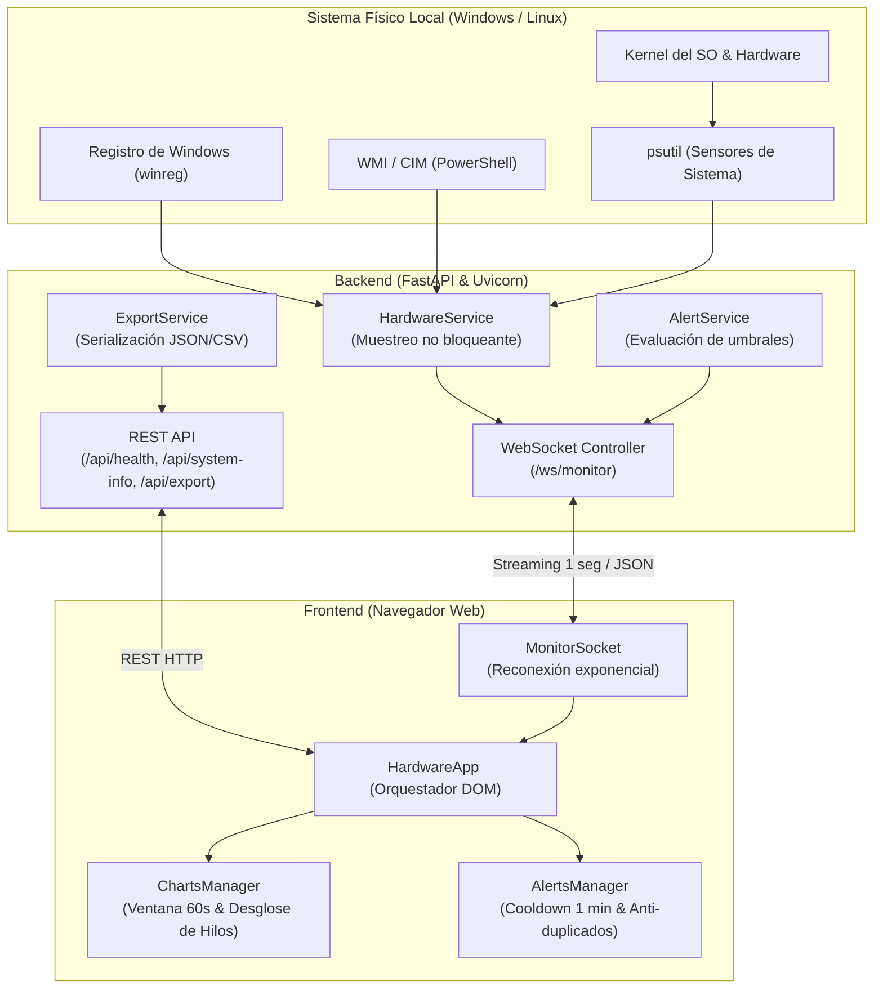

# Monitoreo de Salud del Hardware

> **Aplicación web minimalista y moderna para la supervisión y diagnóstico en tiempo real del rendimiento del host local (CPU por hilos, memoria RAM DDR5/MT/s, almacenamiento y tráfico de red).**

---

## 1. Visión General del Proyecto

**Monitoreo de salud del hardware** es una herramienta de observabilidad local inspirada en la agilidad del Administrador de Tareas de Windows, combinada con una estética editorial elegante y contemporánea. Permite a ingenieros, entusiastas y usuarios avanzados conocer el estado exacto de sus componentes físicos sin sobrecargar el procesador ni depender de herramientas pesadas o servicios en la nube.

La aplicación opera **100% en tiempo real** de forma continua desde que se abre en el navegador, incorporando además la capacidad de **grabar sesiones de telemetría bajo demanda** y exportar los datos recolectados en formatos **CSV** o **JSON**.

---

## 2. Arquitectura del Sistema

El proyecto sigue una arquitectura desacoplada y reactiva impulsada por **FastAPI** en el backend y **JavaScript Vanilla con Chart.js** en el frontend:



---

## 3. Pila Tecnológica (Tech Stack)

### Backend
- **Python 3.10+** (Probado y optimizado en Python 3.11, 3.12 y 3.14).
- **FastAPI**: Framework web moderno, asíncrono y de alto rendimiento.
- **Uvicorn**: Servidor ASGI ultrarrápido basado en `uvloop` y `httptools`.
- **psutil**: Acceso no bloqueante a métricas del kernel (CPU, RAM, disco y red).
- **winreg & CIM/WMI**: Detección profunda de hardware en Windows sin software adicional.
- **Pydantic v2**: Validación estricta y tipado estático de datos y esquemas de alertas.
- **Jinja2**: Motor de plantillas HTML para renderizado del dashboard inicial.

### Frontend
- **HTML5 Semántico**: Estructura limpia y accesible sin frameworks pesados.
- **CSS3 Vanilla**: Sistema de diseño con variables CSS (`--bg-primary`, `--accent-olive`, etc.).
- **Chart.js v4**: Renderizado fluido en lienzo `<canvas>` con animaciones desactivadas (`animation: false`) para 60 FPS estables y consumo inferior al 1% de CPU.
- **WebSockets Nativos**: Comunicación bidireccional continua con retroceso exponencial (`exponential backoff`).

### Automatización & Pruebas
- **iniciar.bat**: Script de arranque desatendido en 1 solo clic para Windows.
- **pytest & pytest-asyncio**: Suite completa de 12 pruebas unitarias y de integración.

---

## 4. Características Principales

### 4.1. Monitoreo 100% en Tiempo Real
- Conexión instantánea al cargar la página: no requiere presionar "Iniciar" para comenzar a ver gráficos y métricas (comportamiento idéntico al Administrador de Tareas).
- Frecuencia de muestreo configurable de **1 segundo**.

### 4.2. Desglose y Aislamiento por Hilos de CPU (Threads)
- Muestra el porcentaje de uso total agregado de la CPU y de **cada hilo lógico individual**.
- **Aislamiento con 1 clic**: Haz clic sobre cualquier hilo en la rejilla o en el selector superior para enfocar exclusivamente la gráfica temporal de ese hilo.
- **Detección de saturación**: Si un hilo supera el 85%, el sistema advierte de forma visual para diagnosticar cuellos de botella monohilo.

### 4.3. Inspección Profunda de Especificaciones del Sistema
- **Procesador**: Nombre comercial exacto leído directamente desde el Registro de Windows (`ProcessorNameString`), identificando con precisión microarquitecturas Intel Core y AMD Ryzen.
- **Memoria RAM**: Detección de tecnología física instalada (**DDR5** o **DDR4**) y velocidad configurada en **MT/s** (MegaTransferencias/s) vía consultas CIM/WMI cacheadas.
- **Sistema Operativo**: Reconocimiento fidedigno de **Windows 11** junto a su edición comercial (**Versión 24H2**) y número exacto de compilación (**Compilación 26100.9711**).

### 4.4. Sistema Inteligente de Alertas y Enfriamiento (Cooldown)
- Clasificación de severidad en **Advertencia (Warning)** y **Crítico (Critical)** para CPU, RAM y Almacenamiento.
- **Persistencia visual**: Las alertas se mantienen visibles y las tarjetas parpadean en el color de advertencia.
- **Anti-duplicación**: No satura la pantalla con avisos repetidos.
- **Período de enfriamiento (Cooldown de 1 minuto)**: Si el usuario descarta manualmente una alerta haciendo clic en su botón `✕`, dicha alerta queda silenciada exactamente durante 60 segundos antes de volver a notificarse si el problema persiste.

### 4.5. Grabación y Exportación de Sesiones
- Botón **"Iniciar Grabación"** para registrar telemetría durante pruebas de estrés, videojuegos o renderizados.
- Exportación directa a **CSV tabular** (compatible con Excel/Pandas) o **JSON estructurado**.

### 4.6. Seguridad Defensiva Incorporada
- Vinculación por defecto a `127.0.0.1` (localhost).
- Middleware de cabeceras HTTP de seguridad:
  - `Content-Security-Policy` (CSP) estricta.
  - `X-Frame-Options: DENY` (anti-clickjacking).
  - `X-Content-Type-Options: nosniff` (anti-MIME-sniffing).
  - `Referrer-Policy: strict-origin-when-cross-origin`.
  - Inyección segura de datos en el frontend mediante `textContent` (prevención de XSS).

---

## 5. Estructura del Proyecto

```
hardware_monitor/
├── app/
│   ├── api/
│   │   ├── __init__.py
│   │   ├── routes.py          # Endpoints REST (/api/health, /api/system-info, /api/export)
│   │   └── websockets.py      # Controlador de WebSocket continuo (/ws/monitor)
│   ├── core/
│   │   ├── __init__.py
│   │   ├── config.py          # Configuración global tipada con Pydantic Settings
│   │   └── security.py        # Middleware de cabeceras HTTP de seguridad (OWASP)
│   ├── schemas/
│   │   ├── __init__.py
│   │   ├── alerts.py          # Modelos de umbrales y eventos de alerta
│   │   └── metrics.py         # Modelos de CPU, RAM, Disco, Red y SystemInfo
│   ├── services/
│   │   ├── __init__.py
│   │   ├── alert_service.py   # Lógica de evaluación de límites y criticidad
│   │   ├── export_service.py  # Conversión de telemetría a CSV y JSON
│   │   └── hardware_service.py# Recolección no bloqueante con psutil, winreg y CIM
│   ├── static/
│   │   ├── css/
│   │   │   └── styles.css     # Paleta cálida minimalista y diseño responsive
│   │   └── js/
│   │       ├── alerts.js      # Gestor de alertas con anti-duplicados y cooldown de 1 min
│   │       ├── app.js         # Orquestador principal del cliente web
│   │       ├── charts.js      # Gráficos Chart.js con ventana de 60s y desglose por hilos
│   │       └── socket.js      # Cliente WebSocket con reconexión exponencial
│   ├── templates/
│   │   └── index.html         # Plantilla Jinja2 con tarjetas, especificaciones y gráficos
│   └── main.py                # Entrada principal de FastAPI, CORS y ciclo de vida
├── tests/
│   ├── __init__.py
│   └── test_backend.py        # 12 pruebas automatizadas con pytest
├── .env                       # Variables locales activas
├── .env.example               # Plantilla de variables de entorno para control de versiones
├── .gitignore                 # Reglas de exclusión para Git (ignora .venv, .env, etc.)
├── iniciar.bat                # Script de arranque en 1-clic para Windows
├── README.md                  # Documentación rápida de instalación y uso
├── requirements.txt           # Dependencias de producción y pruebas
├── RESUMEN_PROYECTO.md        # Este documento
└── GUIA_SUBIR_GITHUB.md       # Guía paso a paso para publicar el repositorio
```

---

## 6. Verificación de Calidad y Tests

El proyecto cuenta con una cobertura de pruebas completa sobre todos sus módulos críticos. Para ejecutar los tests:

```bash
# Con el entorno virtual activado:
pytest -v
```

**Resultado actual:**
- `test_healthcheck`: Comprueba la disponibilidad del endpoint de liveness.
- `test_render_dashboard`: Verifica la entrega exitosa del HTML del dashboard.
- `test_system_info`: Valida la detección de CPU, RAM DDR5/MTs y Windows 11.
- `test_hardware_service_snapshot`: Verifica que psutil devuelva snapshots consistentes.
- `test_alert_service_triggers_correctly`: Comprueba disparo de alertas en umbrales límite.
- `test_export_service`: Valida la estructura de exportación en JSON y CSV.
- `test_api_export_endpoint`: Prueba la descarga HTTP con cabeceras de adjunto.
- `test_security_headers_present`: Comprueba la presencia de CSP, X-Frame-Options, etc.
- `test_websocket_ping_pong`: Verifica comunicación bidireccional y latencia.
- `test_websocket_start_and_stop_lifecycle`: Valida la máquina de estados del streaming.
- `test_websocket_malformed_command_handling`: Comprueba tolerancia a errores de JSON.
- `test_export_validation_errors`: Valida rechazo de solicitudes de exportación vacías.

**Estado:** 12/12 pruebas aprobadas exitosamente.
